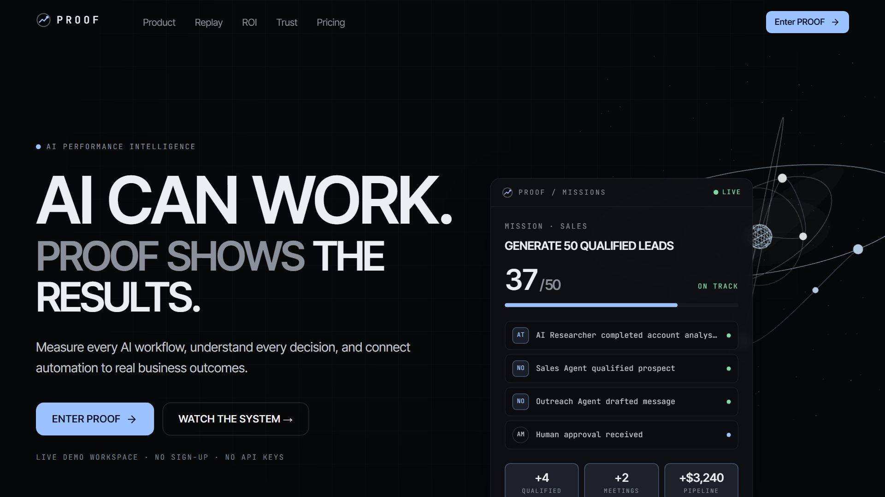
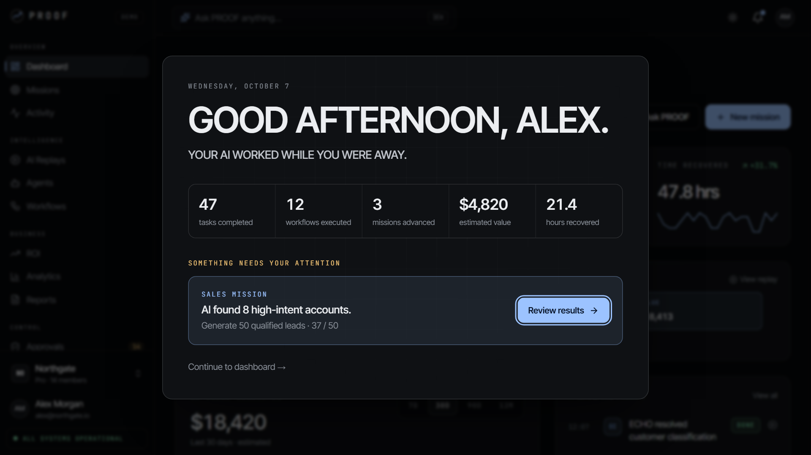
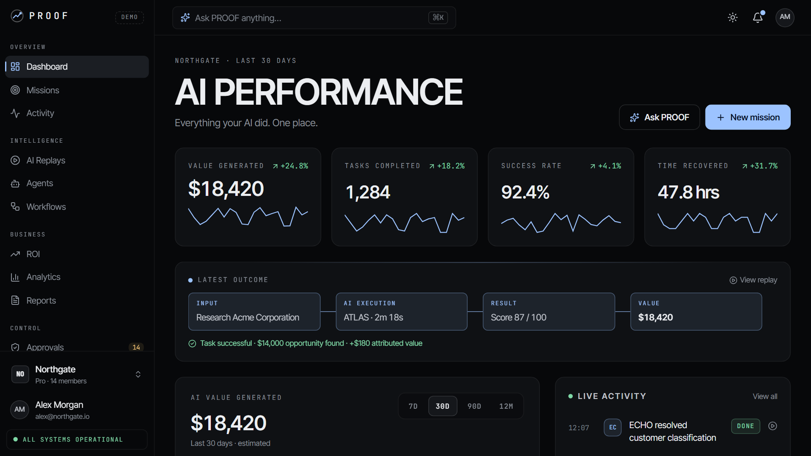
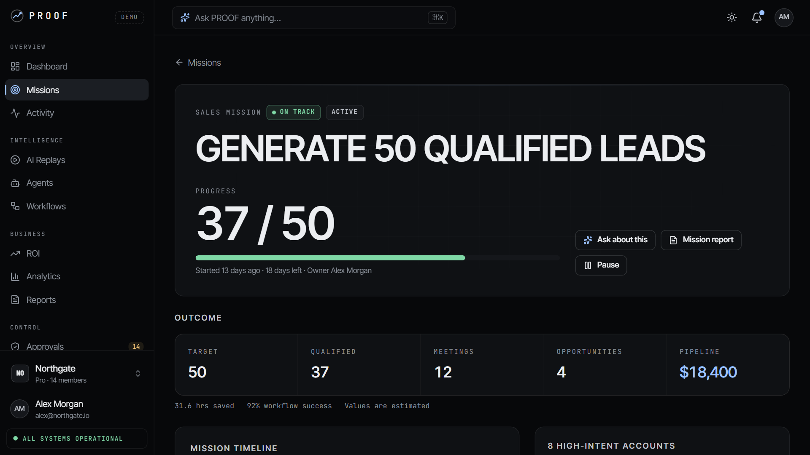
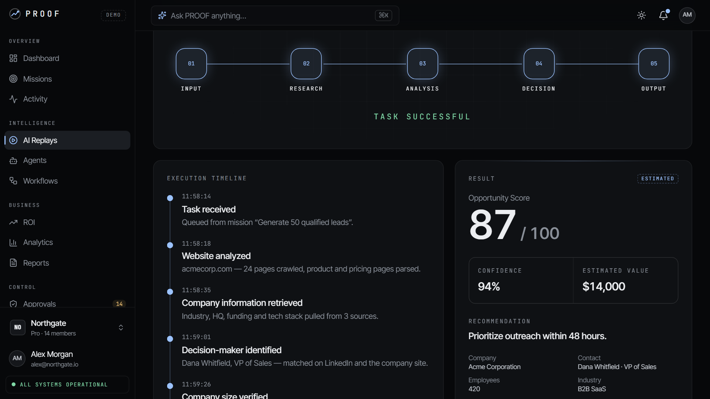
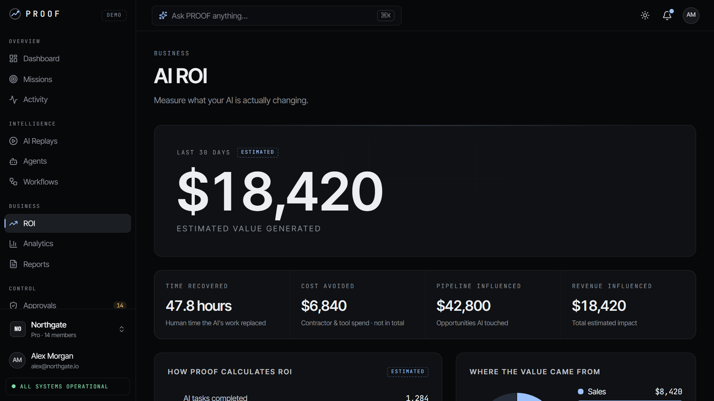
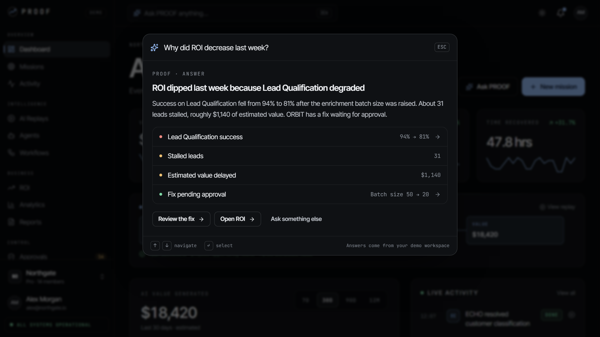
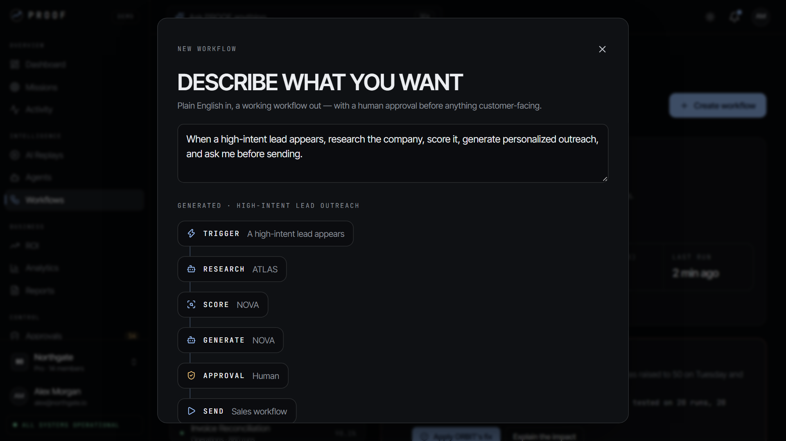

# PROOF — AI Performance & Outcome SaaS Template

**AI can work. PROOF shows the results.** PROOF is a premium AI SaaS template: a cinematic marketing site plus a complete AI performance and outcome dashboard. Companies set a goal, AI agents do the work, and PROOF records every step, replays how each task was done and calculates the business impact. It runs fully in demo mode, with no API keys or backend.

**[Live demo](https://proof-muad1.vercel.app)** · **[Get the template ($49)](https://muadme.gumroad.com/l/lngppq)**

## What's inside

- **Scroll-story landing page.** Ten chapters take the visitor from raw AI noise to measurable results. The hero has a live animated mini-product and a 3D "Proof Core" (on desktop; phones get a lightweight 2D canvas version).
- **"Your AI worked while you were away."** The first click opens a brief that drops the viewer straight into a mission.
- **15-route app:**
  - Overview: dashboard, missions, mission detail, activity audit log
  - Intelligence: AI replays, agents, workflow builder
  - Business: ROI center, analytics, reports
  - Control: approvals, integrations, settings, billing
- **AI Replay.** Watch any task step by step: an animated execution diagram, playback speed and scrubbing, a result card, and an error state with retry.
- **⌘K command center.** Ask "Why did ROI decrease last week?" and get a structured answer, or jump anywhere in the app.
- **Mission creator and plain-English workflow builder.** Workflows have draggable nodes and human-approval steps.
- **Transparent ROI.** Every number comes from editable assumptions and is labelled *Estimated*.
- **Approval center.** Review the exact emails, edit them, or approve or reject. Every decision is logged in the activity feed.
- **Seeded demo workspace:** 22 missions, 56 replayable tasks, 120+ events, 32 workflows, 42 approvals and a year of performance data. The numbers agree on every screen.
- **Also:** dark and light themes, mobile layouts with bottom navigation, keyboard and screen-reader support, and reduced-motion support.

## Built with

React 19 · TypeScript · Vite · Tailwind CSS v4 · Framer Motion · React Three Fiber · React Router

- One config file for brand, agents, metrics, ROI inputs, pricing and feature flags. Theme colours are CSS variables.
- A typed mock AI layer (`generateMission`, `generateReplay`, `generateROI`…) that you swap for a real model provider.

## More templates

- [SYNTRA](https://github.com/Muaddd1/SYNTRA) — AI business command center SaaS template with an AI command palette, an approval queue with audit log, a visual workflow builder and five AI agents ([demo](https://syntra-muad1.vercel.app))
- [VANTA DETAIL](https://github.com/Muaddd1/VANTA-DETAIL) — automotive detailing template with a scroll-driven 3D car, a live quote builder and a seven-step booking flow ([demo](https://vanta-detail-muad1.vercel.app))
- [NEXFORM](https://github.com/Muaddd1/NEXFORM) — futuristic personal-trainer template with a 3D athlete, a personalisation quiz, a 3D body map and a real booking flow ([demo](https://nexform-muad1.vercel.app))
- [FADEHOUSE](https://github.com/Muaddd1/FADEHOUSE) — premium barbershop template with a real booking flow and a 3D clipper built in code ([demo](https://fadehouse-muad1.vercel.app))
- [ÉLORA](https://github.com/Muaddd1/ELORA) — luxury beauty-salon template with a real booking flow and a 3D serum bottle ([demo](https://elora-muad1.vercel.app))
- [VELLUTO](https://github.com/Muaddd1/VELLUTO) — cinematic 3D coffee-brand template with a scroll-driven espresso cup ([demo](https://velluto-muad1.vercel.app))
- [AURELIA](https://github.com/Muaddd1/AURELIA) — luxury e-commerce React template ([demo](https://aurelia-template-phi.vercel.app))
- [VANTA](https://github.com/Muaddd1/VANTA) — premium digital-product storefront template ([demo](https://vanta-creator-os.vercel.app))
- [AURUM](https://github.com/Muaddd1/AURUM) — luxury gold jewelry template with a live gold price calculator and Arabic RTL ([demo](https://aurum-template-muad1.vercel.app))
- [PLINTH](https://github.com/Muaddd1/PLINTH) — single-file interior design studio template ([demo](https://plinth-template.vercel.app))
- [GOLDEN CRUST](https://github.com/Muaddd1/GOLDEN-CRUST) — pizza restaurant template with a 3D pizza hero ([demo](https://golden-crust-muad1.vercel.app))

## About this repository

This is a showcase repository: it holds screenshots only. The full source code is available on **[Gumroad](https://muadme.gumroad.com/l/lngppq)**.

All company names, people and figures in the demo are fictional.

## Author

Built by [Mouad Sehli](https://muad-portfolio.vercel.app) ([GitHub](https://github.com/Muaddd1)), freelance front-end developer (React, TypeScript, Tailwind). More work and contact details are on the [portfolio](https://muad-portfolio.vercel.app).
